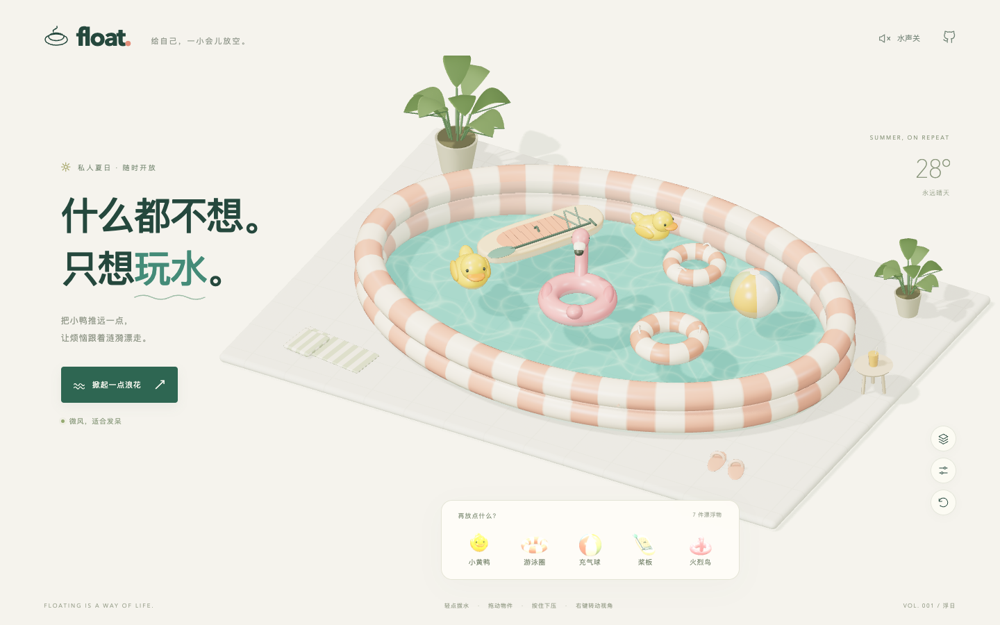
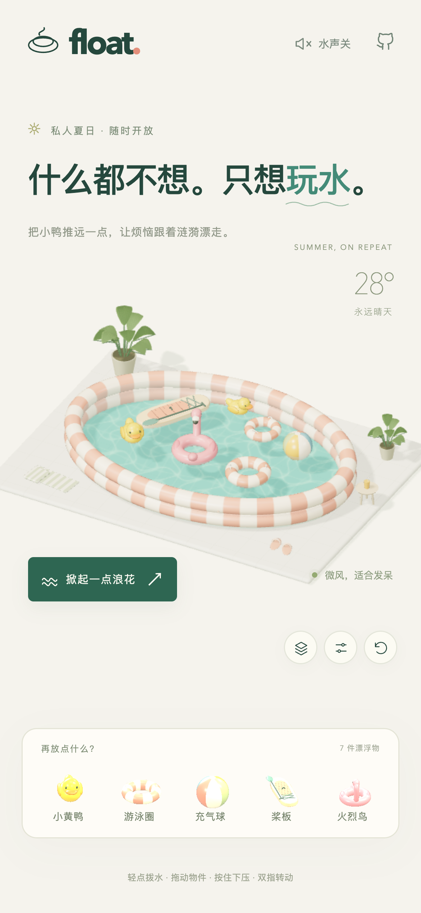

# Float · 浮日泳池

一小池永远晴天的夏天。可交互的 3D 充气泳池，有小黄鸭、游泳圈、充气球、桨板和火烈鸟浮圈。

**[打开在线 Demo](https://zzhuangxd.github.io/float-pool/)** · 手机和电脑均可使用，无需登录。



## 怎么玩

| 操作 | 效果 |
| --- | --- |
| 轻点水面 / 手指在水面滑动 | 涟漪向四周传播，并在池边反射 |
| 拖动物件 | 通过物理弹簧拖拽，留下水波，与其他漂浮物碰撞 |
| 按住物件约 0.4 秒，松开 | 压入水中，再弹回水面；拖动过后不会误触长按 |
| 点击下方玩具 | 新玩具从空中落进泳池，最多 22 件 |
| 双指转动 / 电脑右键拖动 | 旋转视角；捏合或滚轮缩放 |
| 右下角按钮 | 切换俯视、调节风浪、重新摆放 |
| 右上角水声按钮 | 开关合成水声，默认关闭 |

## 物理效果如何实现

参考的是[这个可交互洗碗池视频](https://www.xiaohongshu.com/explore/6ae191560000000013001c00)中拨水、拖拽和物件扰动水面的手感。场景、模型、代码和材质为本项目独立实现，不包含原视频、原作者游戏资源或模型。

### 1. 真正传播的水波

`src/water.js` 在 112 × 80 网格上求解带阻尼的二维波动方程。椭圆池边采用反射边界。点击、拖动、物件入水都会向同一个高度场注入扰动；波纹会传播、叠加、反射和衰减，并非几个循环播放的涟漪贴图。

### 2. 浮力、惯性和碰撞

`src/physics.js` 使用 [cannon-es](https://pmndrs.github.io/cannon-es/docs/) 刚体引擎。每件玩具有多个浮力采样点，依据实时水位施加浮力、阻力和力矩，呈现倾斜、摇晃与回弹。桨板使用长轴采样；游泳圈用一圈球形碰撞体，保留中间的空洞；充气球按球冠浸没体积计算浮力，不会因滚动而失去浮力。空心玩具加入底部配重的扶正力矩，深压后能够恢复。

物件的入水速度、垂直位移、水平运动和碰撞会反过来扰动水面，形成双向反馈。拖拽使用弹簧力。物理以 120 Hz 固定步长推进，与屏幕刷新率分离。

### 3. 通透的水面

`src/water-renderer.js` 使用 [Three.js](https://threejs.org/docs/)：高度纹理驱动水面顶点和法线，屏幕空间折射显示水下模型和池底，Fresnel 与高光表现水面反射。池底的动态焦散为程序化近似。支持高精度颜色附件的设备使用浮点折射目标，否则使用普通颜色目标。

### 4. 手机使用

竖屏与横屏分别安排构图和控制区；使用 Pointer Events 处理单指拨水、拖拽、长按，双指交给视角控制。手机端限制像素比、降低折射目标与阴影分辨率；帧率偏低时进一步自动降分辨率。后台标签页暂停模拟。全部脚本、模型和纹理本地打包，运行时不依赖 CDN、远程字体或外部素材 API。

这是交互用的高度场水体，并非完整三维流体：不模拟翻卷浪头、溢水或可压缩气囊；池边碰撞体与玩具碰撞体也做了简化。

## 本地开发

需要 Node.js 22.12+ 或更新版本。

```sh
npm ci
npm run dev
```

```sh
npm test                 # 水波传播、衰减、浮力、深压扶正、碰撞与步长测试
npm run build            # 构建到 dist/
npm run build:pages      # 构建到 docs/，用于 GitHub Pages
```

GitHub Pages 从 `main` 分支的 `/docs` 目录发布。修改源码后，重新构建 `docs/` 并一同提交。

## 浏览器验证

`tests/browser.mjs` 在真实 Chrome 中检查 1440 × 900、390 × 844 和 320 × 740 视口，并使用触摸事件验证手机拖拽与长按。`tests/webkit.mjs` 用 WebKit 检查手机竖屏、横屏的渲染、点击和浮沉恢复。它们是浏览器模拟，不能代替所有实体手机的性能测试。运行结果、截图保存到被 Git 忽略的 `artifacts/`。

```sh
# macOS 默认使用 /Applications/Google Chrome.app 中的 Chrome
npm run test:browser

# 其他环境可指定 Chrome 可执行文件
CHROME_PATH=/path/to/chrome npm run test:browser

PLAYWRIGHT_BROWSERS_PATH=./artifacts/browsers npx playwright install webkit
PLAYWRIGHT_BROWSERS_PATH=./artifacts/browsers npm run test:webkit

# 对已部署的版本运行同样的测试
DEMO_URL=https://zzhuangxd.github.io/float-pool/ npm run test:browser
```

手机预览：



## 技术与许可

Three.js、cannon-es、Vite；项目代码采用 MIT 许可。所有三维模型由几何体、曲线和程序化材质生成，无外部美术资产。
